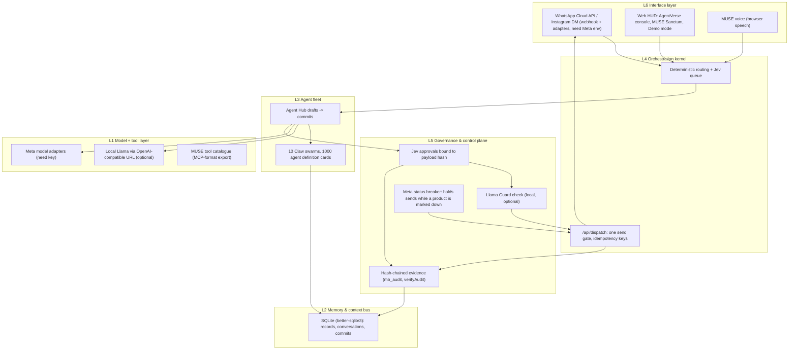

# MeTaBos — Cyber AI Business OS

**A self-hostable business workspace for founders and small businesses, with
SQLite invoicing, inventory, CRM, approval-gated AI tasks and audit evidence.**

Run your business. Approve what matters. Verify what happened.

[](https://github.com/CodesbyFebin/MuzeBOS--The-Zero-Trust-Business-OS/actions/workflows/ci.yml)

[Documentation](docs/search/README.md) · [Self-host](docs/search/self-hosting.md) ·
[Invoice approvals](docs/search/invoice-approvals.md) ·
[WebLLM inference](docs/search/webllm-inference.md) ·
[Evidence and limits](docs/search/verification.md) · [Contribute](CONTRIBUTING.md)

**Release posture: single-operator local preview (package 0.1.1).** The project
name describes a security design goal; it is not an independent certification or
production-readiness claim. MeTaBos extends the attributed FounderOS/GladOS source.

## Why this exists

More businesses are now run by one person with AI help. Alibaba.com's president
told Business Insider that an estimated 30% to 40% of the platform's customers are
solo entrepreneurs, with AI agents doing work such as listings, customer service
and marketing ([Business Insider, 2026](https://www.businessinsider.com/ai-agents-one-person-companies-china-openclaw-alibaba-president-2026-3)).
In PwC's May 2025 survey of 308 US executives, 79% said AI agents were already
being adopted in their companies, and 66% of those adopters reported measurable
productivity value ([PwC AI agent survey](https://www.pwc.com/us/en/tech-effect/ai-analytics/ai-agent-survey.html)).

The problem: a solo founder wants AI to take on sales follow-ups, invoicing,
stock and support, but giving a model write access to money and inventory is a
risk. MeTaBos keeps the AI as a **copilot**: it drafts, classifies, summarizes
and proposes structured actions; the owner reviews the exact payload and
approves; deterministic code does the write and records evidence.

**Who it's for:** solo founders, one-person companies and small teams who want
their commerce, money, messaging and AI help in one self-hosted workspace.

**Governance ideas, as built in this repo:**
- **Jev approvals** bound to a hash of the exact payload; any change after
  approval invalidates it.
- **Atomic invoice issuance** with an in-transaction stock recheck,
  idempotency keys and money in integer minor units.
- **Spend limits** for model calls stored in the database (per-call and
  per-day ceilings).
- **Role checks on the server** for every business-record read and write.
- **Hash-chained audit evidence** you can verify and export.
- **Meta model adapters** behind a provider interface; nothing runs live
  without a configured key and prices.

**Real stack:** Next.js 15, TypeScript, SQLite (better-sqlite3), vitest and
Playwright. No other database, queue, vector store or orchestration service is
required.

## Hackathon reviewers

This is an **existing FounderOS-based product**. Only the new submission-PR delta
is proposed as event work: Baseten Muse Spark Open routing, explicit Meta Spark
selection, a completed-draft → Jev reminder handoff and reproducible demo tooling.
Provider adapters are implemented and fixture-tested; **live API execution remains
unverified**. No eligibility, prize or entire-product event-build claim is made.

Start with [provenance and contribution disclosure](HACKATHON.md),
[the judge guide](docs/hackathon/JUDGES.md), [criteria mapping](docs/JUDGING.md), the 3-minute **Demo mode** at `/workspace/builder/demo`,
[the demo/video script](docs/hackathon/DEMO.md) and
[qualification evidence](docs/hackathon/VERIFICATION.md).
`npm run hackathon:demo -- --fixture both` runs without model credentials.

## Architecture (MeTaBos six-layer stack, as built)

Layer names come from the owner's METABOS v5 design (AI Studio, Oct 29). Each box below names what **this repo actually contains**; models and services the v5 design listed but this repo does not run are left out.



## Business model (proposed)

Nothing here has been sold; there are no customers or revenue. Prices are **proposed** and untested.

**Deploy tiers**

| Tier | For | What runs where |
|---|---|---|
| Cloud SaaS (proposed) | Solo founders, creators, D2C SMBs | Hosted MuZe, WhatsApp/Instagram via the owner's own Meta app |
| Hybrid (proposed) | Teams of 50–500 | Models hosted; records, PII and evidence in the customer's VPC |
| Sovereign on-prem + edge (proposed) | Regulated buyers | Self-hosted (this repo already runs on one machine with SQLite), local Llama, no outbound model calls |

**Proposed pricing** (from the v5 design, labelled proposed): Free ₹0 (1 agent, Meta channels), SMB ₹4,999/mo, Growth ₹24,999/mo, Enterprise custom.

**Open-source service lines for India (proposed):** support and AMC contracts, OSS licence and compliance audits (SBOM), migration and integration, managed OSS hosting, security and vulnerability management, OSPO setup, an OSS-to-agent bridge for open ERP/CRM, training in Indian languages, and an India OSS marketplace.

## Go-to-market (India SMBs and creators on WhatsApp) — plan, not results

1. **Wedge:** one workflow — a WhatsApp lead arrives, MUSE drafts the reply, the owner approves from the phone. Shown end to end in Demo mode.
2. **First users:** the owner's own brands (workspaces are created by hand; none are seeded), then Kochi small businesses reached in person.
3. **Channel:** Click-to-WhatsApp ads drafted in the ads wizard (writes need Meta App Review for `ads_management`).
4. **Language:** voice and UI in English first; Hindi, Malayalam and Tamil voice selection exists in the Sanctum.
5. **Trust as the pitch:** every send is approved and in the evidence chain, which matters when an owner hands a bot their customers.
6. **Milestones to prove:** live Meta test app with one real inbound message; ten consenting businesses; measured reply time before and after. None are done yet.

## What is MeTaBos?

MeTaBos organizes daily business work into Orders, Money, Talk, Stock and Growth,
with weekly operations/AI tools and setup controls below. Mission Control reads
persisted records for approvals, reminders, stock alerts, activity and real
customer/product/order relationships. Its 18 primary destinations organize the
205 requested pillars; a page's local scope and provider dependencies remain
explicit. Page count is not a count of fully deployed integrations.

| Area | Implemented scope | Boundary |
| --- | --- | --- |
| Commerce | Customers, catalog, order drafts, merchant invoice profile and issuance | Merchant-supplied business/tax details |
| Approval | Exact canonical payload hash, expiry, stock recheck and atomic commit | A model cannot authorize its own business write |
| Inventory | Stock movements and bounded local stock/warehouse modules | Supplier and delivery services need separate integration |
| Money | Integer minor units, invoice snapshots, UPI request and manual reconciliation | Request ≠ settlement; no universal zero-fee claim |
| Workflows | Durable local workflow state, approvals, retry policy and evidence | Only explicitly implemented tools execute |
| AI workspace | Persistent draft queue, Jev review, bounded delegation and worker leases | Live providers and physical WebGPU inference unverified |
| Provider pages | Local records, secret references, connection probes and queued outboxes | Configuration/probe ≠ successful dispatch |
| Evidence | Filterable/exportable local event chain and source-linked records | A DB administrator can rewrite an unanchored chain |

## Run on your own machine

Use **Node.js 22** and the locked dependencies:

```sh
npm ci
npm run dev
```

Open `http://localhost:4100`. Real mode is the default; no fabricated business
records are inserted. Configure an operator password under Settings → Security
before any remote access. The startup wrapper restricts binding until setup.
For production compilation: `npm run build`, then `npm start`.

Read [self-hosting](docs/search/self-hosting.md) and
[operations/recovery](docs/METABOS-OPERATIONS.md). `MUZEBOS_DB` selects commerce
storage; `GLADOS_DB` selects inherited workspace storage. Secrets remain in
ignored environment files. Use private TLS and the correct `MUZEBOS_ORIGIN`.
Responsive web access is supported; no native Android/iOS or offline-sync release
is claimed.

## Try approval-bound invoicing

1. Add merchant details, a customer and a product with stock.
2. Create a draft; review quantities, prices, tax and the exact payload hash.
3. Approve and issue before expiry. Stock is rechecked inside the transaction.
4. Inspect the issued invoice, inventory movement and audit evidence.
5. Payment stays pending until evidence is recorded. Independently check the bank
   before manual reconciliation; it is labelled separately from provider settlement.

See [invoice approval](docs/search/invoice-approvals.md),
[API](docs/METABOS-API.md) and [UPI/tax limits](docs/search/upi-and-tax.md).
Local tax calculations are not GST filing or government e-invoice registration.

## WebLLM, Jev and model routing

Open Brain → Inference & agent workspace (`/workspace/brain/inference`) for
persistent tasks. Small/medium/large routing is deterministic. Jev binds approval
to the exact task, model and configuration. Browser WebLLM loads an explicit
Llama model in a Web Worker; a separate Node worker supports configured Ollama,
Meta Wonder API and OpenRouter text routes. Failed attempts require review;
there is no silent paid fallback in this persistent workspace.

The merged feature stack also includes `/workspace/brain/runtime`, an experimental
interactive proposal interface with different cost/fallback behavior. Its write
proposal gate is not the persistent dispatch gate. See
[the distinction and setup](docs/search/webllm-inference.md).

Muse Code/Wonder Full, OpenClaw tool execution and zkVM proving remain blocked
until their external runtime, isolation and verification bridges are qualified.
No live model call, 24-hour uptime or zk proof is claimed by this release.

## Verification and contributions

```sh
npm run typecheck
npm test -- --maxWorkers=4 --minWorkers=1
npm run build
npm run docs:build
```

Browser qualification uses disposable DBs and Playwright; never point it at your
business database. Read [the integration/search release record](docs/METABOS-SEARCH-RELEASE.md)
for this change's executed checks and [feature/evidence limits](docs/search/verification.md)
for what they establish. Older verification reports apply to their recorded revisions.

[Contributing](CONTRIBUTING.md) explains reproduction, tests and evidence standards.
[Security reporting](SECURITY.md) covers private disclosure. Do not post credentials,
customer data or private invoice records in issues.

## Public documentation and search

The answer-oriented [documentation hub](docs/search/README.md) covers concrete
setup, invoice, inference, payment and data questions. `npm run docs:build` exports
seven static pages to `site/` with distinct metadata, canonical links, structured
source/article data and a public-docs-only sitemap. Those pages are prepared for
separate hosting; their generated canonical URLs do not mean deployment is live.
The operational app sends `noindex` directives and keeps its authentication gate.

No special file, keyword count or schema guarantees search rankings or AI citations.
See [search implementation and measurement](docs/SEARCH-OPTIMIZATION.md).

## Attribution and upstream work

Derived from the supplied FounderOS (on GladOS) source. Original MIT copyright
and attribution remain in [LICENSE](LICENSE); upstream names remain in internal
compatibility code. MeTaBos changes: CodesbyFebin, 2026.

The 29-repository review separates source/licensing from live integrations.
Read [reviewed integrations](docs/METABOS-UPSTREAM-INTEGRATIONS.md) and
[third-party notices](THIRD_PARTY_NOTICES.md). External services, model weights and
provider terms retain their own licences and limits.

> **Naming note:** the product is now MeTaBos. Environment variables keep the `MUZEBOS_` prefix so existing deployments keep working, and an existing `data/muzebos-business.db` is still opened when no `data/metabos-business.db` exists. The GitHub repo name is unchanged.
