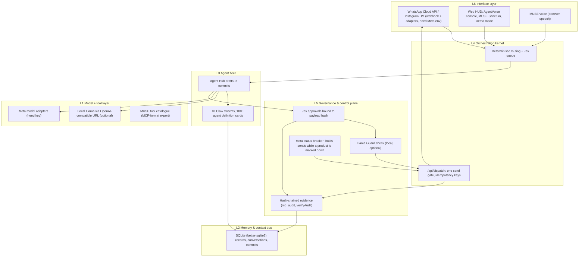

# Why Meta: strategic-fit memo for MuZe (MeTaBos)

**Status:** This is a thesis written by the MuZe team. MuZe has **no relationship with Meta**: no partnership, investment, endorsement, App Review approval, Tech Provider status or contact. Nothing below claims traction, revenue, users or customers, because none has been measured. Market statements are framed as hypotheses to check against Meta's own public reports before use.

## What MuZe is today (verifiable in this repo)
- An approval-first business OS for small businesses and creators. Every outbound action (WhatsApp, Instagram, email, ads) is a proposal that a person approves in Jev and then sends through one gate, `/api/dispatch`.
- A hash-chained evidence ledger (`mb_audit`, `verifyAudit`) behind every decision, revert, cherry-pick and blame view.
- A Meta integration surface (`/workspace/developer/meta-integration`) that reports the real state of each build-order step and shows "Not configured" until the env or a token exists.

## Fit with Meta's platform (why it matters to Meta)
1. **Meta API usage.** The product is built on official Graph API surfaces: Login with Facebook (12 scopes, all App Review-gated), signed webhooks (X-Hub-Signature-256), WhatsApp Cloud API, Instagram messaging, Marketing API (read first, writes later), Catalog and Conversions API. Graph throttling codes (4, 17, 32, 613, 80000–80014) are honoured with exponential backoff, so the client is well-behaved by design.
2. **WhatsApp Business adoption.** The Click-to-WhatsApp lead pipeline turns inbox threads into staged leads with follow-up reminders and approval-gated replies. Hypothesis: this lowers the effort for a small business to respond on WhatsApp, which is the behaviour Meta's business messaging depends on. We have not measured this.
3. **Advantage+ and SMB / creator ad spend in India.** Ad creation is a draft-then-approve wizard. ROAS is shown only from real insights, and pause rules are proposals. Hypothesis: owners who trust the guardrails are more willing to run their first campaigns. Ads writes are blocked until Meta App Review grants `ads_management`. No spend figures are claimed here.
4. **Safety via approval-gated agents.** Agents never send on their own. Each send is bound to a payload hash, approved by a named person and recorded in the evidence chain, and can be blamed or reverted. This matches the scrutiny Meta applies to automated messaging and ads.

### Architecture (MeTaBos six-layer stack, as built)

Layer names come from the owner's METABOS v5 design (AI Studio, Oct 29). Each box below names what **this repo actually contains**; models and services the v5 design listed but this repo does not run are left out.

### Business model (proposed)

Nothing here has been sold; there are no customers or revenue. Prices are **proposed** and untested.

**Deploy tiers**

| Tier | For | What runs where |
|---|---|---|
| Cloud SaaS (proposed) | Solo founders, creators, D2C SMBs | Hosted MuZe, WhatsApp/Instagram via the owner's own Meta app |
| Hybrid (proposed) | Teams of 50–500 | Models hosted; records, PII and evidence in the customer's VPC |
| Sovereign on-prem + edge (proposed) | Regulated buyers | Self-hosted (this repo already runs on one machine with SQLite), local Llama, no outbound model calls |

**Proposed pricing** (from the v5 design, labelled proposed): Free ₹0 (1 agent, Meta channels), SMB ₹4,999/mo, Growth ₹24,999/mo, Enterprise custom.

**Open-source service lines for India (proposed):** support and AMC contracts, OSS licence and compliance audits (SBOM), migration and integration, managed OSS hosting, security and vulnerability management, OSPO setup, an OSS-to-agent bridge for open ERP/CRM, training in Indian languages, and an India OSS marketplace.

### Go-to-market (India SMBs and creators on WhatsApp) — plan, not results

1. **Wedge:** one workflow — a WhatsApp lead arrives, MUSE drafts the reply, the owner approves from the phone. Shown end to end in Demo mode.
2. **First users:** the owner's own brands (workspaces are created by hand; none are seeded), then Kochi small businesses reached in person.
3. **Channel:** Click-to-WhatsApp ads drafted in the ads wizard (writes need Meta App Review for `ads_management`).
4. **Language:** voice and UI in English first; Hindi, Malayalam and Tamil voice selection exists in the Sanctum.
5. **Trust as the pitch:** every send is approved and in the evidence chain, which matters when an owner hands a bot their customers.
6. **Milestones to prove:** live Meta test app with one real inbound message; ten consenting businesses; measured reply time before and after. None are done yet.

## What is not built (honest gaps)
- Page publishing adapter, catalogue write sync, Conversions API event sending (consent, dedup and test events), billing and partner mode.
- Meta business verification, App Review and Tech Provider onboarding — none started.

## What would have to be true before any conversation
Real usage data from consenting businesses, completed App Review, and a privacy and security review. Until then this memo is a product-direction document, not a pitch with numbers.
