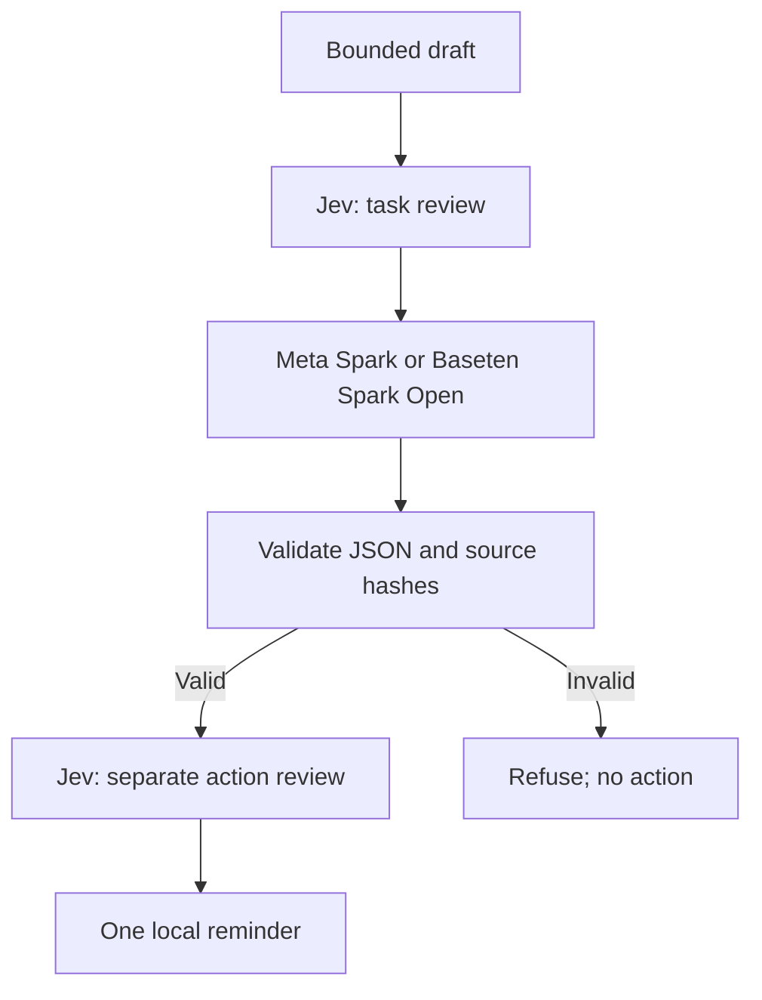

# Judge guide

MuzeBOS is an existing self-hostable business workspace. **This entry demonstrates
a new, bounded model-to-business handoff**, not a newly built entire Business OS.
Read [`HACKATHON.md`](../../HACKATHON.md) before evaluating the event contribution.

Problem: a small-business founder needs AI help without letting model text silently
become a business action. The new path turns a Meta/Baseten draft into a separately
reviewed reminder proposal, binding the proposed action to its source evidence.

## Inspect the new path

1. Run `npm ci` with Node 22.
2. Run `npm run hackathon:demo -- --fixture both`. No account or network is used by
   the fixture adapters. Both outputs and scripted approvals are labeled fixtures.
3. Inspect the report path printed by the runner. Check provider/model, task and
   output hashes, action hash and audit validity. Missing usage stays unknown.
4. Run `npm test -- tests/muzebos-hackathon.test.ts` for the refusal/tampering/replay
   cases. Run the full test/type/build commands in `VERIFICATION.md` for regression.
5. For the interface, run `npm run dev`, open `/workspace/brain/inference`, choose
   Meta or Baseten, create a draft, review its hash, and separately review a valid
   completed proposal under `/workspace/brain/runtime#jev`. Live worker execution needs
   credentials, server opt-in and an approved task. An unconfigured route is blocked.

## Meta contribution

The new Baseten lane targets the guide's Muse Spark Open model; Meta Spark is an
explicit, allowlisted choice for the existing Meta Model API adapter. Model text
is not policy: the client validates the exact JSON shape and passes it to Jev.
The model API is not an authorization service and neither provider attests to our
local action. Existing FounderOS and MuzeBOS work is credited separately.

## Verification boundary

The PR contains real provider transports and fixture qualification. It does not
contain a successful live call or an independently attested benchmark. The final
video must say which mode is shown. Do not present synthetic response timing as
model latency. Reported live timing is one observed request, not a performance SLA.
The new action scope is one local reminder; wider product ambitions are roadmap.

[Runbook/video script](DEMO.md) · [Qualification](VERIFICATION.md) ·
[Draft X post](X-POST.md) · [Provenance](../../HACKATHON.md)
